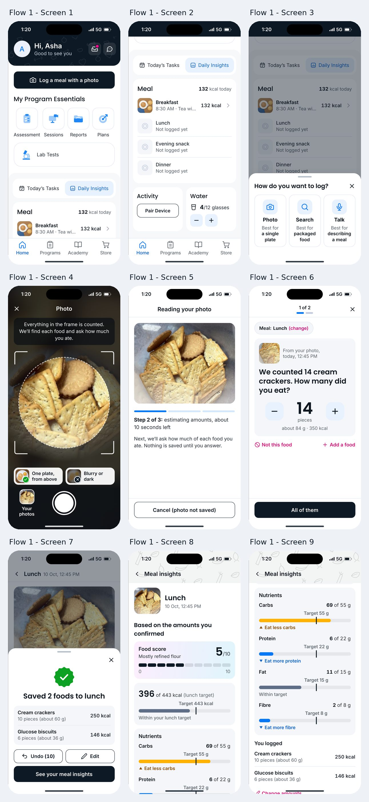

# Flow 1: Ask before saving

The photo is a draft. After reading it, the app asks one question per food, such as "We counted 14 cream crackers. How many did you eat?", and saves only when every question is answered. A 10-second Undo follows the save, as in the other two flows.

**Live:** <https://codewtirtha.github.io/meal-log-prototypes/flow-1-ask-before-saving/>

## Screen by screen

| Screen | The brief | In the prototype |
|---|---|---|
| 1. Home (top) | Under "Hi, Asha", a full-width "Log a meal with a photo" button; the rebrand notice moved to an inbox dot; no centre tab | Navy button right under the greeting. The header has an inbox icon with a pink dot (it opens "Fitterfly is now PB Health. Your progress is saved.") and a chat icon. Tab bar: Home, Programs, Academy, Store |
| 2. Home scrolled | Meal card listing today's meals; no second logging button | Breakfast (logged at 8:30 AM), then Lunch, Evening snack and Dinner marked "Not logged yet". No banner and no Add Meal link |
| 3. Method sheet | "How do you want to log?", three equally styled tiles with "Best for" hints: Photo ("a single plate"), Search ("packaged food"), Talk ("describing a meal"); close (✕) | As asked. Search and Talk say they are not part of this prototype |
| 4. Camera | Caption "Everything in the frame is counted. We'll find each food and ask how much you ate."; a slim row above the shutter with one good and one bad example; "Your photos"; close | As asked: "One plate, from above" (good) and "Blurry or dark" (avoid), the same two examples as Flows 2 and 3. "Your photos" holds the tub (today, 12:45 PM), breakfast and yesterday's lunch plate |
| 5. Analysing | The photo; "Step 2 of 3: estimating amounts, about 10 seconds left"; "Cancel (photo not saved)" | Three steps over 12 s, with a live countdown, and the line "Nothing is saved until you answer" |
| 6. Question cards | "1 of 2"; "We counted 14 cream crackers. How many did you eat?"; large 14 with minus and plus; primary "All of them"; "Not this food"; chip "Meal: Lunch (change)"; link "Add a food" | As asked, with a close-up from the photo and the photo's time ("From your photo, today, 12:45 PM"). Card 2 asks about the 6 glucose biscuits |
| 7. Saved | "Saved 2 foods to lunch"; "Undo" (10-second countdown); "Edit"; primary "See your meal insights" | A sheet over the saved meal, listing both foods with pieces, grams and kcal. "Undo (10)" counts down and disappears at 0 |
| 8. Insights (top) | *Brief: a top toast "+10 Fitgems for logging lunch". Removed with Fitgems.* | Opens on "Based on the amounts you confirmed", score 4/10 on a scale and "496 of 443 kcal (lunch target)" |
| 9. Insights | "Based on the amounts you confirmed"; score 4/10 on a scale; "496 of 443 kcal (lunch target)"; bars labelled "Eat less carbs" and "Eat more protein" where relevant; link "Change amounts" | Nutrient bars: "Eat less carbs", "Eat more protein", "Eat more fibre"; fat shows "Within target". Then "You logged" and "Change amounts" |

## Task 5: yesterday's plate

From "Your photos", yesterday's 1:10 PM plate gives three question cards ("1 of 3"). The plate's foods are weighed, so the questions read "We found about 200 g of rice. How much did you eat?"; the stepper moves 25 g at a time and the button follows it ("All of it", "I ate 100 g"). The meal is saved as Lunch, 9 Oct, 1:10 PM.

## Behaviour worth knowing

- When a count is changed, the main button follows it: "All of them" becomes "I ate 10", and 0 becomes "I ate none".
- "Not this food" offers look-alikes (salted or jeera crackers; Marie or digestive biscuits; jeera or brown rice; moong or masoor dal; aloo matar or mixed vegetable sabzi), "Something else" and "I didn't eat any of these".
- Undo, within 10 seconds, takes the person back to the last question with their answers kept and nothing saved. Undo after an edit puts the saved meal back as it was.
- "Edit" and "Change amounts" go through the same questions again and save as "Saved changes to lunch".
- The ✕ on a question card asks before stopping; nothing has been saved at that point.

## Files

- `index.html`: the page and Flow 1's own styles.
- `flow.js`: Flow 1's screens and actions.
- Shared theme, data and screens: [`../shared`](../shared).

Tasks, theme, deployment and screenshots: see the [main README](../README.md).
