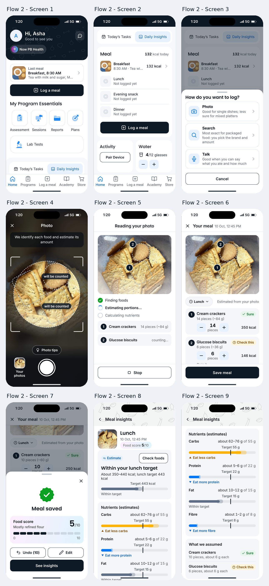

# Flow 2: Show the estimate

The app shows what it detected, what it assumed and how sure it is: numbered outlines on the photo, pieces and grams for every food, a "Sure" or "Check this" tag, look-alike foods to switch to, and ranges instead of single numbers on the insights.

**Live:** <https://codewtirtha.github.io/meal-log-prototypes/flow-2-show-the-estimate/>

## Screen by screen

| Screen | The brief | In the prototype |
|---|---|---|
| 1. Home (top) | A "Last meal" strip with its photo and a filled "Log a meal" button; a "Now PB Health" header badge; centre tab "Log food" | As asked, except that the centre tab is also called **"Log a meal"**, so one action has one name. The badge opens the rebrand note; the last meal is breakfast until lunch is saved. Tab bar: Home, Programs, Log a meal, Academy, Store |
| 2. Home scrolled | No blue banner; the Meal card uses the same filled "Log a meal" button | As asked |
| 3. Method sheet | Photo, Search and Talk, each with an accuracy note (Photo: "Good for single dishes; less sure for mixed platters"); no "New" badge; "Cancel" | As asked. Search: "Most exact for packaged food: you pick the brand and amount". Talk: "Good when you can say what you ate and how much" |
| 4. Camera | Live outlines around each food, labelled "will be counted"; caption "We identify each food and estimate its amount"; "Photo tips" chip (one good, one bad example); "Your photos" | As asked, with a close (✕). The tips are the same two examples as Flows 1 and 3 |
| 5. Analysing | Labelled stages (finding foods, estimating portions, calculating nutrients); foods appear as found; "Stop" | Over 8 s, the foods appear with numbered outlines, then their amounts, then their calories |
| 6. Review | Photo with numbered outlines. Row 1: "Cream crackers, 14 pieces (~84 g), 350 kcal", tag "Sure". Row 2: "Glucose biscuits, 6 pieces (~36 g), 146 kcal", amber tag "Check this", chips "Marie biscuits" and "Digestive biscuits". Minus and plus beside each count; no trash icons; meal chip "Lunch"; "Add food"; primary "Save meal" | As asked. A count of 0 leaves a food out, so no delete button is needed. Changing a "Check this" food, or picking a look-alike, turns its tag into "Checked" |
| 7. Saved | "Meal saved"; score 4 on a 0-10 scale with the reason "Mostly refined flour"; "Undo", "Edit", primary "See insights" | A sheet over the review, with a close (✕). "Undo (10)" counts down and disappears after 10 seconds, as in Flows 1 and 3 |
| 8. Insights (top) | *Brief: a "+10" Fitgems counter with a tooltip. Removed with Fitgems.* | Opens on the verdict labelled "Estimate", "About 450–540 kcal; lunch target 443 kcal" and "Check foods" |
| 9. Insights | Verdict labelled "Estimate"; "About 450-540 kcal; lunch target 443 kcal"; "Check foods" beside the verdict | Nutrient ranges with a labelled target line and **Flow 1's action labels**: "Eat less carbs", "Eat more protein", "Eat more fibre" (before: "Over target", "Under target"). Then "What we assumed" lists each food's amount and tag |

## Task 5: yesterday's plate

From "Your photos", yesterday's 1:10 PM plate shows three numbered outlines: 1 rice, about 200 g, "Sure"; 2 dal, about 150 g, "Sure"; 3 aloo gobi, about 120 g, "Check this", with "Aloo matar" and "Mixed vegetable sabzi" as look-alikes. These foods are weighed: the steppers move 25 g at a time. The meal is saved as Lunch, 9 Oct, 1:10 PM.

## Behaviour worth knowing

- The calorie range adds plus or minus 5 % for a food marked "Sure" (or checked) and plus or minus 20 % for "Check this". The verdict reads "Over", "Close to" or "Within" your target from that range.
- "Check foods" and "Edit" reopen the review; saving then reads "Changes saved".
- "Stop" during the analysis goes back to the camera, and nothing is saved.

## Files

- `index.html`: the page and Flow 2's own styles.
- `flow.js`: Flow 2's screens, actions and the outline positions (in each photo's own pixels).
- Shared theme, data and screens: [`../shared`](../shared).

Tasks, theme, deployment and screenshots: see the [main README](../README.md).
