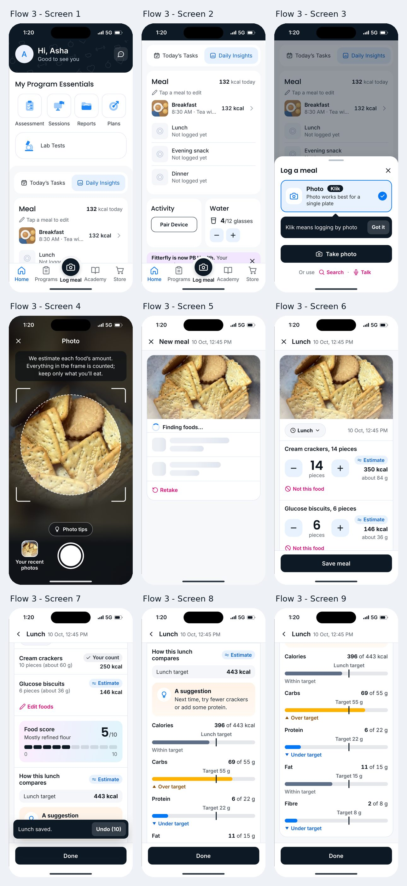

# Flow 3: One meal card

The fewest steps. From the photo on, every screen is a state of one scrolling meal card: analysing, review, saved, insights. Each correction shows its effect at once in a live nutrition summary.

**Live:** <https://codewtirtha.github.io/meal-log-prototypes/flow-3-one-meal-card/>

## Screen by screen

| Screen | The brief | In the prototype |
|---|---|---|
| 1. Home (top) | A raised centre tab "Log meal" with a camera icon replaces Trackers; the rebrand as a dismissible line at the foot of Home | Tab bar: Home, Programs, Log meal, Academy, Store. The raised button sits in a bump of the tab bar rather than floating over the page |
| 2. Home scrolled | Meal card listing today's meals, "Tap a meal to edit"; no banner or "Add Meal" link | As asked. "Fitterfly is now PB Health. Your progress is saved." sits at the foot of Home with a close (✕) |
| 3. Method sheet | "Photo" pre-selected with a primary "Take photo" button and the hint "Photo works best for a single plate"; first-time coach mark "Klik means logging by photo"; Search and Talk as small links; close (✕) | As asked, and the Photo option carries the app's own name for it, a **"Klik"** label, which the coach mark points at, so the coach mark explains a word that is on screen. The coach mark has "Got it" and shows only the first time |
| 4. Camera | Caption "We estimate each food's amount. Everything in the frame is counted; keep only what you'll eat."; "Photo tips" chip with one good and two bad examples; "Your recent photos" | As asked, but the tips now show **one good and one bad example** ("One plate, from above"; "Blurry or dark"), the same as Flows 1 and 2, so the flows can be compared |
| 5. Card, analysing | Photo at the top; two placeholder rows "Finding foods..."; "Retake" link | As asked; the analysis takes 5 s. ✕ in the top bar stops and goes home |
| 6. Card, review | "Cream crackers, 14 pieces" and "Glucose biscuits, 6 pieces", each marked "Estimate", with large numbers and steppers; meal chip "Lunch"; below, a live nutrition summary that updates when a count changes; "Add food" row; primary "Save meal" | As asked. A changed count is tagged "Your count", and the summary values that changed flash briefly. Each found food has **"Not this food"**, which opens its look-alikes (as Flow 1's sheet and Flow 2's chips do): Marie or digestive biscuits, salted or jeera crackers, jeera or brown rice, moong or masoor dal, aloo matar or mixed vegetable sabzi, and "Something else" |
| 7. Card, saved | Snackbar "Lunch saved. Undo"; score 4/10 with its scale | After saving, the card scrolls so the score sits just above the snackbar. The snackbar's "Undo (10)" counts down for 10 seconds (before: 8 s), as in Flows 1 and 2. Each saved food **keeps its tag**: "Estimate" if its amount was not changed, "Your count" if it was |
| 8. Card, insights | *Brief: a chip "+10 Fitgems for logging" under the score. Removed with Fitgems.* | "How this lunch compares", with an **"Estimate"** tag while any amount is still the app's estimate ("Your counts" once every amount was set by the person); "Lunch target 443 kcal" and the suggestion "Next time, try fewer crackers or add some protein" |
| 9. Card, insights | Labelled lunch target; the verdict as a suggestion, "Next time, try fewer crackers or add some protein" | Bars for calories, carbs, protein, fat and fibre with labelled targets and directional colours |

## Task 5: yesterday's plate

From "Your recent photos", yesterday's 1:10 PM plate becomes a card with three rows: "Rice, 200 g", "Dal, 150 g" and "Aloo gobi, 120 g", each marked "Estimate". These foods are weighed: the steppers move 25 g at a time. The meal is saved as Lunch, 9 Oct, 1:10 PM, and with half the rice the suggestion reads "Next time, try less rice or add some protein."

## Behaviour worth knowing

- Changing a food with "Not this food" keeps its amount and its tag: the amount is still an estimate until the person changes it.
- "Edit foods" on the saved card, or tapping lunch on Home ("Tap a meal to edit"), turns the card back into the review state with "Save changes".
- Undo on the snackbar turns the card back into the review state, with nothing saved (or the earlier version restored, after an edit).
- The suggestion is written from the amounts: the food with the most carbohydrate when carbs or calories are over, and "add some protein" when protein is under.

## Files

- `index.html`: the page and Flow 3's own styles.
- `flow.js`: Flow 3's screens and actions.
- Shared theme, data and screens: [`../shared`](../shared).

Tasks, theme, deployment and screenshots: see the [main README](../README.md).
